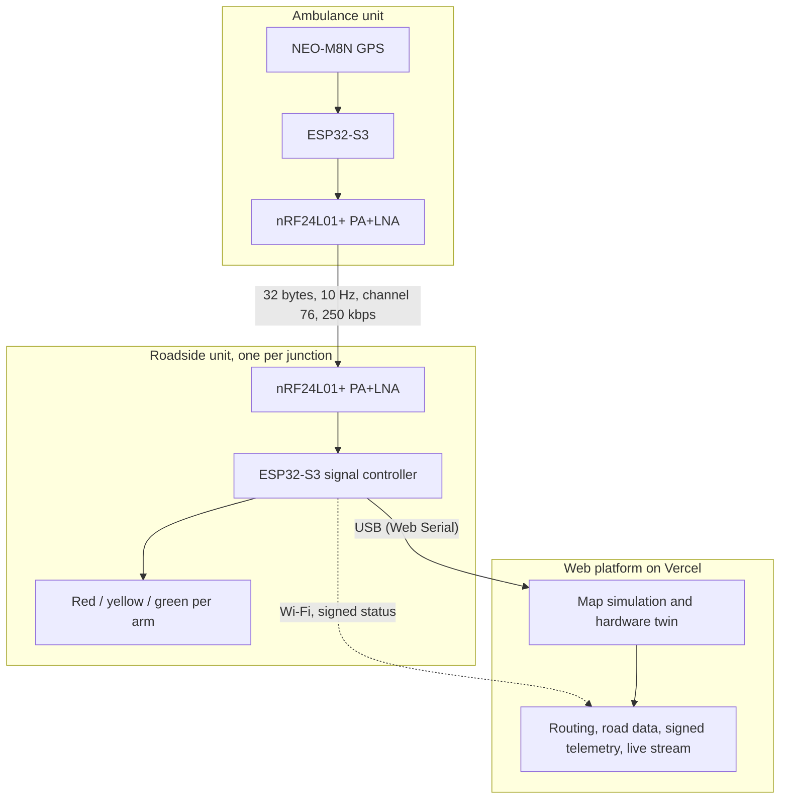
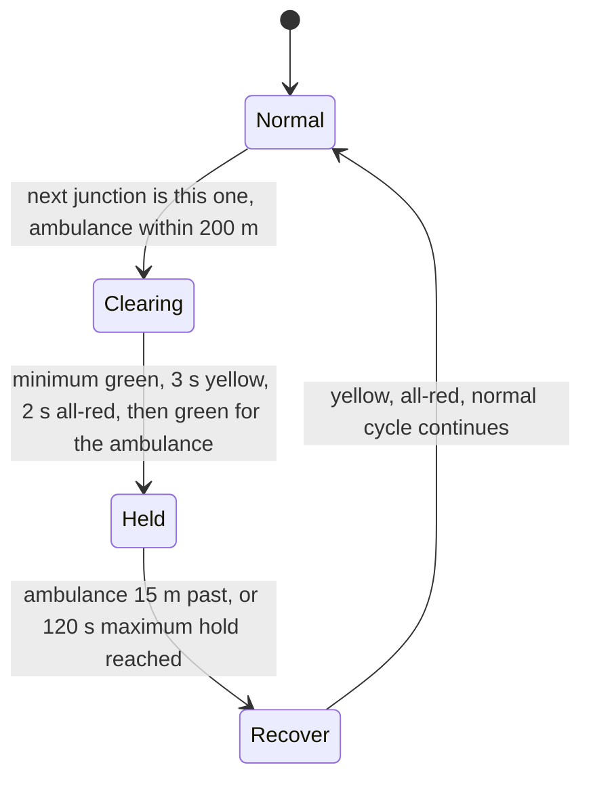

# Vector Aid V2I: route-aware traffic-signal pre-emption for ambulances

**Live demo: [v2i-ambulance.vercel.app](https://v2i-ambulance.vercel.app)**

An ambulance tells the traffic lights ahead of it that it is coming, which way it will turn, and how
urgent the call is. Only the junctions that are actually on its route react. They end the current
green safely and give the ambulance's road a green before it arrives, then return to normal once it
has passed.

This folder is the infrastructure side (vehicle-to-infrastructure, V2I) of Vector Aid. The
[Transmitter](../Transmitter) and [Receiver](../Receiver) folders hold the vehicle-to-vehicle
system that warns nearby drivers.


## The problem

An ambulance loses time at every red light. Crossing a red is dangerous, for the crew and for
traffic that has a green. Simple pre-emption systems react to any emergency vehicle in range, so
signals near the ambulance change even when it will never pass through them. That disrupts
traffic for nothing.

## What it does

1. **Knows the route.** The start and the hospital are set on real streets from OpenStreetMap. The
   route follows the street centrelines, and every junction on it is identified. Each junction is
   classified as a T, a Y, a 4-way or a multi-arm junction. The turn the ambulance will make there
   (straight, left, right or U-turn) is worked out from the change in heading, Δθ.
2. **Broadcasts 10 times a second.** The ambulance unit sends a 32-byte radio packet: its position,
   speed, heading, **the next junction on its route**, the turn there, the hospital and the urgency.
3. **Only the right junction reacts.** A roadside unit acts when two things are both true: the
   packet names *it* as the next junction, and the ambulance is within 200 m. Every other unit
   ignores the packet, even one the ambulance passes right beside.
4. **Changes the lights safely.** The current green finishes its minimum time, then goes through
   yellow and all-red before the ambulance's road turns green. There is never more than one green
   at a time.
5. **Holds, then lets go.** The green stays until the ambulance is 15 m past the junction, then the
   normal cycle resumes. The green is released after 2 minutes at most, so a stopped ambulance
   cannot block the junction.
6. **Handles several ambulances.** When two or three approach the same junction, it serves them in
   order of expected arrival, with more urgent calls moved ahead. The one being served keeps the
   green until it has passed.



## How a junction behaves



| Rule | Value |
|---|---|
| Normal cycle, per road | 12 s green, 3 s yellow, 2 s all-red |
| Minimum green before switching | 5 s |
| Detection distance | 200 m, only for the ambulance's next junction |
| Released after | the ambulance is 15 m past, or 120 s at most (then a 30 s pause for that ambulance) |
| Priority between ambulances | expected arrival time, 4 s earlier per urgency level |
| Roads per junction | up to 5 (3 lamps each, 15 output pins) |

In the worst case a junction needs about 10 s to make the ambulance's road green safely: 5 s
minimum green, 3 s yellow and 2 s all-red. At 40 km/h the ambulance covers about 110 m in that
time, so a junction that hears it at 200 m is green with roughly 90 m to spare.

## The web platform

The demo has two views that share one live simulation.

**Map simulation:**

- Choose the offline demo street grid, or real OpenStreetMap streets for any area up to about 4 km
  across.
- Set an ambulance start and a hospital and dispatch it. A roadside unit appears at every junction
  on the route.
- Drop extra traffic lights by hand; each one snaps to the nearest junction.
- Add civilian traffic (18, 36 or 60 cars) that queues at red lights.
- Watch each junction's lights, the 200 m detection circles, the queues and a live event log.
- Run seven ready-made scenarios, and verify all of them with one click.

**Hardware twin:**

- The ambulance unit's live readings: speed, heading, GPS, progress and the next turn.
- The exact 32 bytes it transmits, with each field labelled.
- The roadside unit's signal heads for every road, with the level of each output pin.
- Real boards connect over USB in Chrome or Edge, and their lights are shown next to the
  simulation's.


### Try the demo

- In **Scenarios**, run **S6: 3 Ambulances Priority** and watch the junction serve the nearest ambulance first.
- Switch to **Hardware twin** to see the radio packet and the signal heads change.
- Switch the map to **OpenStreetMap**, click **Set the start**, then click a street in your city. Its streets load first; this can take up to a minute.

The map simulation runs in any modern browser. Connecting real boards needs Chrome or Edge on a
desktop.

## Scenarios

Each scenario runs on its own and checks the safety rules automatically.

| Scenario | What it shows |
|---|---|
| S1: Normal cycle | Every road at every junction gets its green; nothing is pre-empted without an ambulance |
| S2: Single ambulance | Green on arrival at each junction along a straight run; nearby junctions off the route stay unaffected |
| S3: 4-way left turn | The turn is classified LEFT and the correct road is given green |
| S4: T-junction right turn | Topology classified as a T-junction, turn as RIGHT |
| S5: 4-way straight | Straight through a crossroad |
| S6: 3 ambulances | Three ambulances at 180, 120 and 75 m are served nearest first |
| S7: Multi-junction wave | A green wave along a corridor with a turn in the middle |

Every scenario checks the safety rules:

- never two greens at once;
- a green always ends in yellow, then all-red;
- no junction off the route ever reacts.

All seven pass, both on the demo grid and on a dense test city of about 6,600 road segments.

## The radio packet

32 bytes, little-endian, the same in the firmware (C++) and the web app (TypeScript).

| Bytes | Field |
|---|---|
| 0 | Start marker, 0xA5 |
| 1 | Ambulance number (101 means AMB-101) |
| 2–9 | Current latitude and longitude, degrees × 10⁷ |
| 10–11 | Heading, tenths of a degree |
| 12–13 | Speed, tenths of a km/h |
| 14–21 | Next junction on the route (latitude, longitude) |
| 22–29 | Hospital (latitude, longitude) |
| 30 | Turn at the next junction (low 4 bits) and urgency, 0 to 3 (high 4 bits) |
| 31 | CRC-8 checksum |

A packet with a bad checksum, an impossible position or a speed above 200 km/h is rejected.

## Hardware

| Unit | Parts |
|---|---|
| Ambulance unit | ESP32-S3-DevKitC-1, u-blox NEO-M8N GPS, nRF24L01+ PA+LNA radio |
| Roadside unit | ESP32-S3-DevKitC-1, nRF24L01+ PA+LNA radio, red/yellow/green LEDs for up to 5 roads |

A roadside unit can also report its state over Wi-Fi to the web platform. Each report is signed
(HMAC-SHA256) and timestamped, so it cannot be forged or replayed.

## Built with

| Area | Technology |
|---|---|
| Firmware | ESP32-S3 (Arduino), RF24 |
| Web | Next.js, React, TypeScript, Leaflet, Tailwind CSS |
| Maps and routing | OpenStreetMap (via Overpass), openrouteservice |
| Hosting | Vercel |
| Testing | Vitest; the roadside unit's C++ logic is also tested on a PC |
| AI tools | Model Context Protocol server: Claude can dispatch ambulances, read signal states, decode packets and run the scenarios |

**Security:**

- API keys stay on the server.
- Every page carries a strict content security policy.
- Board reports are signed (HMAC-SHA256), checked against the server clock and protected against replay.
- Every API is rate-limited.

## Status

**Working now:**

- The live web platform, the simulation and all seven scenarios.
- Firmware for both units. It compiles for the ESP32-S3. The roadside unit's decision logic, the
  same C++ that runs on the board, passes safety tests on a PC: one green at a time, yellow and
  all-red between greens, off-route ambulances ignored, nearest ambulance first, and release after
  the maximum hold.

**In progress:**

- Bench and on-road trials with the radios: range, packet loss at speed, several junctions in a row.

This is a research prototype that drives LEDs. It is not a certified traffic-signal controller.

## What's next

- **Field trials:** measure radio range and reliability on real roads at ambulance speeds.
- **One broadcast for vehicles and signals:** the same ambulance message serves both nearby
  drivers (the V2V receivers in this repository) and roadside units.
- **Arrival-time prediction:** learn from logged runs so junctions start clearing earlier on fast or
  congested roads.
- **Stronger device security:** a separate signing key per roadside unit, and certificate checking
  on the boards.
- **Real signal hardware:** drive an actual controller's pre-emption input through an isolated
  output instead of LEDs, with independent conflict monitoring.

## Folder contents

```
V2I/
├── src/          web platform: simulation engine, map, hardware twin, API
├── firmware/     ESP32-S3 programs: ambulance transmitter, roadside receiver and signal controller
├── mcp-server/   tools that let an AI assistant drive and inspect the simulation
├── tests/        simulation, packet, firmware-logic and tool tests
├── docs/         screenshots
└── SETUP.md      build, wiring, flashing and deployment notes for developers
```

Map data © [OpenStreetMap](https://www.openstreetmap.org/copyright) contributors. Routing by
[openrouteservice](https://openrouteservice.org).

Built by Team Vector Aid.
